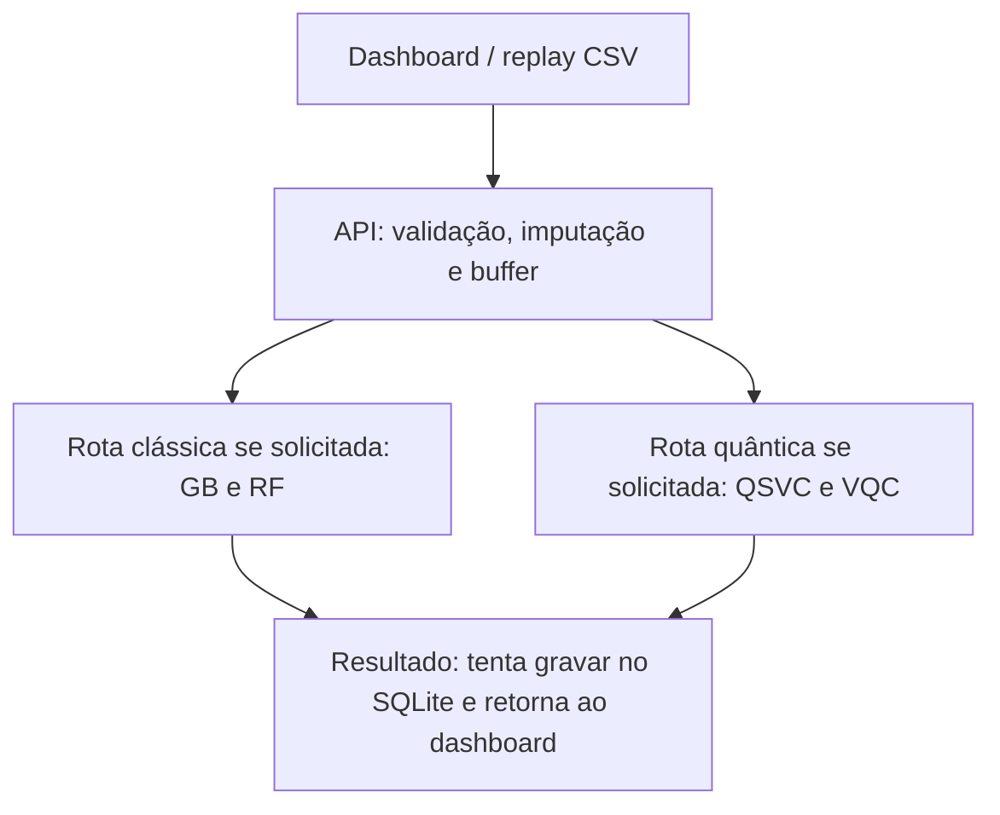
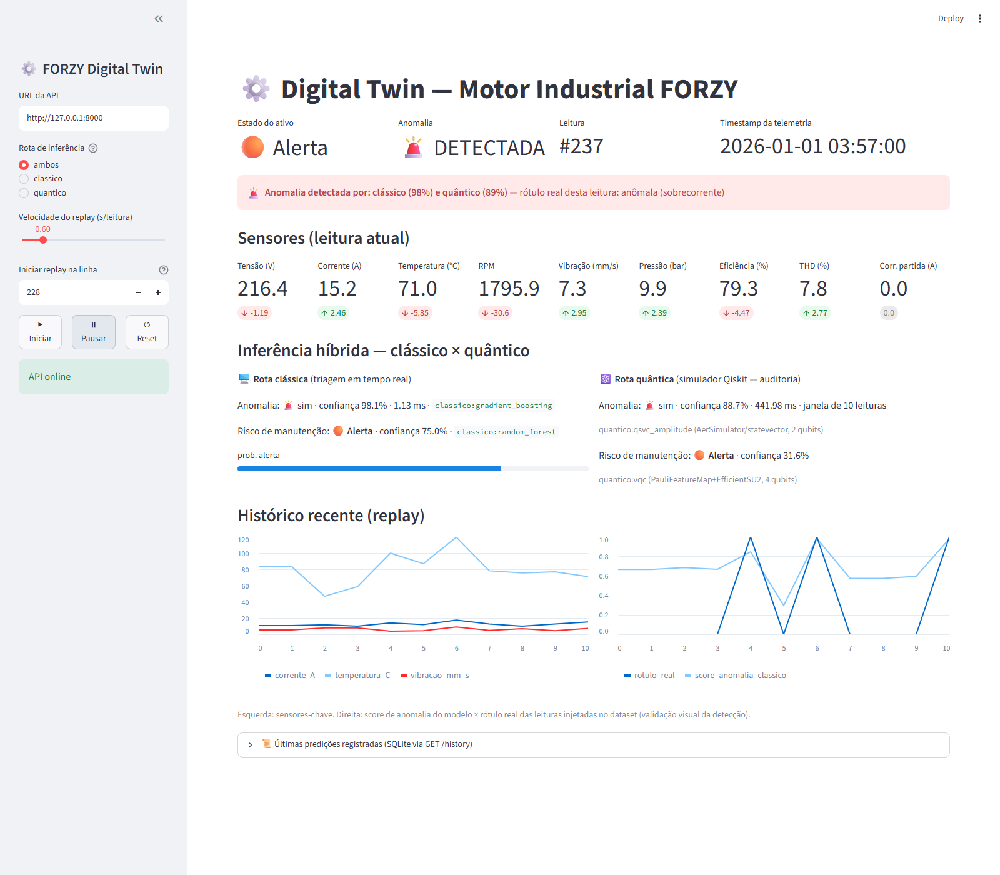
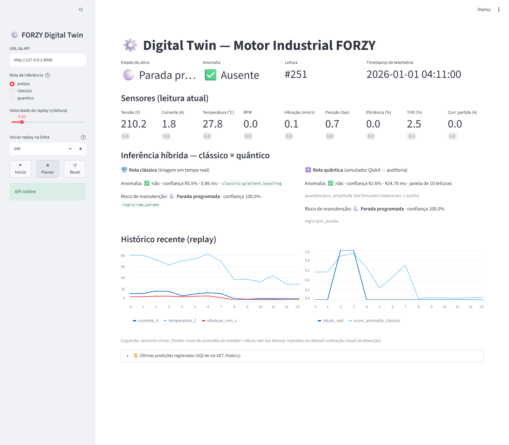

# Documentação Final FORZY - Sprint 4

Data: 03/11/2026

Augusto Oliveira Codo de Sousa - RM502080
Felipe de Oliveira Cabral - RM561720
Gabriel Tonelli Avelino Dos Santos - RM564705
Sofia Bueris Netto de Souza - RM565818
Vinícius Adrian Siqueira de Oliveira - RM564962

## 1. Contexto, objetivo e síntese

O Challenge FORZY propõe aplicar Computação Quântica e Inteligência Artificial ao monitoramento de um motor industrial em um Digital Twin. O problema envolve identificar leituras anômalas e classificar condições associadas à manutenção. A solução recebida conecta telemetria sintética, modelos clássicos e quânticos simulados, uma API e uma interface de acompanhamento.

A sprint 4 consolida essa trajetória e prepara sua comunicação à banca. O escopo desta entrega é documental: organizar os artefatos existentes, explicitar evidências, interpretar os resultados e registrar pendências. Nenhum modelo foi retreinado e nenhuma funcionalidade do produto foi adicionada nesta consolidação.

Um Digital Twin industrial pressupõe representação digital e sincronização com o elemento físico [B05]. Aqui, o replay demonstra a integração; a sincronização com a planta permanece futura. Classificar condição e prever falha futura são objetivos distintos [B06].

### Resultado central

A principal realização é a integração demonstrável dos dois cenários em um protótipo funcional. O Random Forest de manutenção registra 96,26% de acurácia e F1-macro de 0,9279 no holdout histórico. O VQC registra 65,59% e 0,5357, respectivamente. A rota HTTP com ambos os modelos apresenta p95 de 718,792 ms no ensaio fornecido. Esses números são históricos. Na manutenção, medem a aproximação de rótulos sintéticos derivados dos próprios atributos, não antecipação independente de falhas. [E02, E03, E11]

### Leitura executiva

O projeto comprova a viabilidade de integrar QML simulado ao fluxo do Digital Twin. Os artefatos não demonstram vantagem quântica em condições equivalentes, ganho financeiro, redução de paradas reais ou validação em uma planta da FORZY. A classificação de manutenção estima um estado operacional definido por regras sintéticas, sem estimar tempo até falha ou vida útil remanescente.

### Base e rastreabilidade

As evidências do projeto vêm do pacote fornecido e do enunciado. A bibliografia B01-B06 foi consultada nesta revisão para fundamentação conceitual, sem atribuir seu uso às sprints anteriores. As referências E01 a E12 identificam arquivos, código, imagens e conferências documentais. Métricas históricas não foram apresentadas como novas execuções. Os originais foram preservados e inventariados com SHA-256.

Data de consolidação: 03/11/2026. A data da apresentação à banca não foi informada.

## 2. Jornada do POC à integração

Tabela 1. Progressão e alcance das evidências

| Etapa | Objetivo e resultado | Evidência disponível |
| --- | --- | --- |
| Sprint 1 | POC de QML e comparação inicial clássico/quântico. | Histórico descrito no relatório S3. Os artefatos originais da S1 não integram este pacote. |
| Sprint 2 | Dataset consolidado e pipeline de janelas, extração de atributos, PCA e kernel quântico. | Código e CSV embarcados em sprint2_core/. Relatos de validação anteriores em E01 e E09. |
| Sprint 3 | Modelos persistidos, inferência, API FastAPI, SQLite, dashboard Streamlit e avaliação integrada. | Código, modelos, métricas e capturas presentes. |
| Sprint 4 | Consolidação da narrativa, revisão das evidências, documentação final, slides e organização local. | Documentos desta entrega. Sem novos desenvolvimentos. |

### Marcos que podem ser datados

O planejamento da sprint 3 traz a data de 12/08/2026. A capa do relatório anterior informa agosto de 2026. A revisão da sprint 4 ocorre em 03/11/2026. O material descreve refinamentos “após a primeira entrega”, mas não fornece commits, logs ou datas individuais para localizar cada mudança no calendário. [E01, E09]

### Limite da reconstrução histórica

Os indicadores antigos de validação cruzada, eficiência amostral e projeções para hardware real são relatos do documento S3, sem seus resultados brutos completos no pacote. Por isso, o relatório final usa os JSONs persistidos como base numérica principal e não calcula uma curva quantitativa de evolução S1-S4.

A sprint 3 já incorporou classificadores de manutenção e a integração dos cenários. A sprint 4 comunica esse estado e melhora sua auditabilidade. A existência atual de um arquivo comprova sua presença no pacote, mas não determina quando ele foi desenvolvido.

## 3. Dataset e protocolo de avaliação

Tabela 2. Contagem direta do CSV recebido

| Item | Valor conferido |
| --- | --- |
| Leituras / sensores | 5.200 leituras / 9 sensores |
| Anomalias / normais | 424 (8,15%) / 4.776 (91,85%) |
| Famílias de falhas | Rolamento: 150; sobreaquecimento/desbalanceamento: 174; sobrecorrente: 100 |
| Subconjunto adversarial | 120 registros, incluídos nas 424 anomalias |
| Classes de manutenção | Normal 3.371; monitoramento 728; alerta 434; crítico 407; parada programada 260 |
| Janelas de anomalia | 1.039 janelas de 10 leituras, passo 5, rótulo positivo se qualquer leitura for anômala |

Fonte: E07. Conferência por contagem, sem inferência ou retreino, registrada em E11. O relatório S3 cita 430 anomalias; o CSV entregue contém 424. A contagem do arquivo prevalece nesta documentação.

### Protocolos efetivamente implementados

Anomalia clássica: divisão aleatória estratificada 80/20, seed 42, com 4.160 leituras de treino e 1.040 de teste. QSVC: 1.039 janelas, com 831 no conjunto inicial de treino e 208 de teste; o treino é subdividido em 664 janelas para ajuste e 167 para calibração Platt. Manutenção: 4.940 registros operacionais, com 3.952 de treino e 988 de teste; o VQC usa subamostra de 400 registros. [E02, E04]

### O que as métricas significam

Acurácia mede a fração de classificações corretas. F1 da anomalia combina precisão e revocação da classe positiva. F1-macro dá o mesmo peso às quatro classes de manutenção. AUC avalia a ordenação dos escores em diferentes limiares. A forte predominância de leituras normais torna inadequado interpretar a acurácia isoladamente.

O alvo de manutenção deriva de atributos rolantes de degradação e limites definidos no projeto. Portanto, o resultado mede concordância com esse rótulo sintético, não antecipação comprovada de falhas futuras. [E05, E09]

## 4. Arquitetura da solução entregue

Figura 1. Fluxo consolidado de /predict, conferido no código da sprint 3 [E05, E06]. Diagrama documental revisto em 03/11/2026; nenhuma alteração no produto.

As rotas solicitadas são síncronas; falha de log não bloqueia a resposta.

QSVC combina classificação por margem com kernel quântico; VQC ajusta um circuito parametrizado [B01, B03, B04]. Qiskit Machine Learning fornece componentes para esses fluxos híbridos [B02]. A documentação atual é referência conceitual, não evidência da versão executada no benchmark.

O replay envia nove canais à API. O serviço valida faixas físicas, completa sensores opcionais e mantém até 20 leituras por equipamento. A anomalia clássica usa uma leitura; o QSVC usa as últimas dez. A manutenção usa nove sensores e quatro atributos rolantes no RF, ou apenas os quatro atributos rolantes no VQC. [E05, E06]

### Operação atual e evolução proposta

O parâmetro modelo seleciona classico, quantico ou ambos. A rota clássica não é executada quando a requisição solicita somente quantico. As rotas solicitadas são síncronas no código atual; auditoria assíncrona e gatilho automático são propostas futuras. A seção 10 apresenta as latências medidas; a figura evita misturar essas medições com tempos ilustrativos antigos.

O log SQLite é best effort: uma falha de gravação emite aviso e não impede o retorno da inferência. Assim, a implementação oferece histórico operacional, mas não garante registro durável de toda predição. OPC-UA, IoT de planta e hardware quântico real não estão integrados. [E06]

## 5. Pipeline, contrato e operação

Tabela 3. Interfaces presentes no código

| Interface | Comportamento |
| --- | --- |
| POST /predict | Diagnóstico de anomalia e manutenção. Rotas classico, quantico ou ambos. |
| POST /predict/janela | Anomalia quântica com exatamente 10 leituras explícitas. |
| GET /history | Histórico SQLite com filtro por equipamento e limite de até 500 registros. |
| GET /models | Sensores e métricas históricas dos modelos. |
| GET /health e /docs | Estado do serviço e documentação OpenAPI. |

Tensão, corrente, RPM e temperatura são obrigatórios. Vibração, pressão, eficiência, THD e corrente de partida são opcionais e recebem medianas de operação normal quando ausentes. /predict lista esses campos em sensores_imputados. A ausência de canais que carregam assinaturas de falha limita a interpretação do diagnóstico. [E05, E06]

A anomalia quântica retorna aviso enquanto o buffer não possui dez leituras. A janela corresponde a dez minutos somente sob a cadência assumida de uma leitura por minuto. O contrato não recebe timestamp de sensor para garantir essa cadência. O estado do buffer permanece em memória e se perde ao reiniciar o serviço.

Na manutenção, RPM abaixo de 300 aciona a regra parada_programada. Trata-se de uma convenção do protótipo, sem consulta a agenda de manutenção ou confirmação de que a parada foi planejada. As classes aprendidas são normal, monitoramento, alerta e crítico. [E05]

### Autenticação e limites de operação

FORZY_API_KEY ativa a exigência de X-API-Key nos dois endpoints POST. Sem a variável, a API não exige chave. Os endpoints GET permanecem sem essa proteção. O dashboard, a persistência local e o mecanismo de autenticação atendem a uma demonstração controlada; controles de produção constam no roadmap. [E06]

O JSON de exemplo E10 registra uma resposta histórica. Seu latencia_total_ms é medido antes da gravação SQLite e não corresponde ao tempo HTTP completo.

## 6. Evidência visual da integração

A captura mostra a API online, nove sensores, anomalia detectada e risco de manutenção em alerta. As rotas clássica e quântica aparecem lado a lado com confiança e tempo de inferência. Isso evidencia a apresentação conjunta dos resultados no Digital Twin.

Os percentuais de 98,1% e 88,7% são confianças daquela resposta, não acurácias do modelo. O timestamp pertence ao dataset sintético e não comprova a data de execução ou de desenvolvimento. A captura foi reaproveitada; não é uma nova demonstração realizada na sprint 4.

## 6.1. Parada e divergência entre rotas

### Interpretação do estado do ativo

A interface diferencia a situação de parada e exibe ausência de anomalia no exemplo preservado. A regra de manutenção evita classificar o motor parado pelas quatro classes operacionais. A confiança de 100% exibida nesse caso indica uma regra determinística, não uma probabilidade estatisticamente calibrada.

### Uma leitura e uma janela podem discordar

No JSON E10, a anomalia clássica retorna true com escore 0,9362, enquanto o QSVC retorna false com escore 0,4123. O buffer contém 13 leituras, e a decisão quântica considera as últimas dez. A diferença ilustra que as rotas respondem a contextos temporais distintos; isoladamente, não identifica qual modelo generaliza melhor.

O pacote também preserva dashboard_replay.gif, disponível para demonstração offline.

## 7. Evolução após a primeira entrega

O relatório S3 descreve avanços posteriores à sua primeira entrega. O quadro separa esse relato daquilo que o pacote permite inspecionar. Não há evidência suficiente para afirmar que todos ocorreram depois do encerramento formal da sprint 3. [E01]

Tabela 4. Registro antes/depois com nível de comprovação

| Frente | Antes relatado / depois disponível | Data e evidência |
| --- | --- | --- |
| Testes | Antes: smoke test. Depois: suíte de inferência e API, 32 casos por contagem estática incluindo parametrização. | Após a primeira entrega, sem data individual. Arquivos presentes em E06; execução não refeita. |
| Autenticação | Antes: API sem mecanismo de chave segundo o relato. Depois: proteção opcional dos endpoints POST. | Após a primeira entrega, sem data individual. require_api_key e testes em E06. |
| Carga concorrente | Antes: avaliação limitada segundo o relato. Depois: ensaios de 1, 5 e 20 clientes. | Após a primeira entrega, sem data individual. Script e JSON E03. |
| VQC | Depois: três estratégias adicionais de treino relatadas; configuração original mantida. | Após a primeira entrega, sem data individual. Apenas relato em E01, pp. 7 e 15. |
| Integração contínua | Depois alegado: workflow do GitHub Actions. Arquivo e logs não estão no pacote. | Não verificável. README e E01 citam .github/workflows/tests.yml. |

### Conclusão sobre o avanço técnico

Testes, autenticação e avaliação de carga estão representados por código ou resultados persistidos. Os experimentos adicionais do VQC têm evidência documental secundária. O funcionamento da CI e o instante de cada mudança permanecem pendentes de comprovação. Não se atribuem melhorias numéricas de desempenho à sprint 4.

## 7.1. Evolução documental na sprint 4

Tabela 5. Consolidação executada em 03/11/2026

| Antes | Depois | Evidência nesta entrega |
| --- | --- | --- |
| Relatório centrado na sprint 3. | Narrativa final com contexto, jornada, resultados, pendências e conclusão. | Documentacao_Final_FORZY_Sprint4.pdf e fonte Markdown. |
| Métricas distribuídas em JSONs e narrativa. | Tabelas com unidades, amostras e distinção entre lote, serviço e HTTP. | Seções 8 a 11 e metricas_consolidadas.csv. |
| 430 anomalias citadas no relatório. | 424 anomalias confirmadas no CSV entregue. | conferencia_dataset.json e seção 3. |
| Regra de manutenção sem conferência quantitativa e baseline ausente. | V1.5: regra e baseline conferidas; 988/988 janelas de manutenção no teste se sobrepõem ao treino reconstruído. | Seção 9.1; JSONs e scripts documentais em docs/sprint4/. |
| Afirmações de CI e persistência integral. | CI não comprovada; registro best effort explicitado. | Seções 4, 7 e 12. |
| Arquivo compactado sem guia de entrega final. | README de navegação, inventário de fontes e roteiro de apresentação. | repositorio/README.md, docs/sprint4/ e LEIA-ME_ENTREGA.md. |
| Apresentação final ausente no pacote. | Slides e roteiro com a mesma base factual do relatório. | Apresentacao_Final_FORZY_Sprint4.pptx e PDF. |

Esses avanços tornam o trabalho legível e verificável, sem alterar o produto. A conferência incluiu leitura, contagem, revisão do código e, nas V1.3-V1.5, conferência da regra, baseline e sobreposição temporal nos índices reconstruídos. Os resultados de RF/VQC, testes funcionais e benchmark continuam sendo históricos.

### O que não se pode preencher por inferência

O pacote histórico não contém datas individuais de desenvolvimento, logs das tentativas adicionais do VQC nem histórico Git. A publicação atual organiza os artefatos, mas não recupera essas evidências antigas. O repositório do projeto está indicado na seção 13; a data da banca ainda deve ser confirmada.

## 8. Resultados de detecção de anomalias

Tabela 6. Holdout histórico de anomalia

| Modelo | Acurácia | AUC | F1 anomalia | n treino |
| --- | --- | --- | --- | --- |
| SVM-RBF | 90,48% | 0,9477 | 0,6207 | 4160 |
| Random Forest | 94,52% | 0,9541 | 0,6705 | 4160 |
| MLP | 95,19% | 0,9623 | 0,6795 | 4160 |
| Gradient Boosting | 90,96% | 0,9544 | 0,6083 | 4160 |
| QSVC Amplitude | 85,10% | 0,9083 | 0,8584 | 664 |

Fonte: models/metrics.json [E02]. Os quatro clássicos avaliam leituras pontuais; o QSVC avalia janelas. Valores registrados, não recalculados por inferência.

### O melhor indicador depende do critério

Entre os clássicos, o MLP apresenta a maior acurácia (95,19%), AUC (0,9623) e F1 da anomalia (0,6795). O serviço usa Gradient Boosting por padrão, escolha herdada e registrada no código, embora ele não lidere esses indicadores. Uma troca de modelo exigiria avaliação operacional posterior. [E02, E05]

O QSVC registra F1 de 0,8584 no seu problema janelado e AUC de 0,9083. No conjunto completo, 558 das 1.039 janelas são positivas (53,71%), contra 424 das 5.200 leituras pontuais (8,15%). O rótulo any altera o alvo e sua prevalência. Por isso, o F1 maior não prova superioridade sobre os modelos pontuais, nem 664 janelas versus 4.160 leituras provam eficiência amostral. [E07, E11]

### Limites que afetam a comparação

O pré-processador clássico é ajustado no conjunto completo antes do split. Isso incorpora informação da distribuição do teste e compromete a independência do holdout. As janelas do QSVC se sobrepõem em cinco leituras e depois são divididas aleatoriamente, criando risco de compartilhamento temporal entre treino e teste. [E04]

Além disso, o F1 histórico do QSVC usa predict do pipeline, enquanto a API aplica limiar 0,5 à probabilidade calibrada por Platt. São regras de decisão que podem divergir. A avaliação do limiar efetivamente servido e a comparação em um protocolo comum ficam como melhoria futura.

## 9. Resultados de manutenção

Tabela 7. Holdout histórico de quatro classes operacionais

| Modelo | Acurácia | F1-macro | n treino |
| --- | --- | --- | --- |
| Random Forest, 13 atributos | 96,26% | 0,9279 | 3.952 |
| VQC, 4 atributos rolantes | 65,59% | 0,5357 | 400 |

Tabela 8. F1 por classe do Random Forest

| Normal | Monitoramento | Alerta | Crítico |
| --- | --- | --- | --- |
| 0,9858 | 0,9333 | 0,8929 | 0,8994 |

O RF supera o VQC em 30,67 pontos percentuais de acurácia e 0,3922 de F1-macro nos resultados persistidos. O RF usa mais atributos e mais amostras de treino; portanto, essa diferença descreve as configurações entregues e não isola o efeito de uma técnica quântica. [E02]

Ressalva metodológica: os rótulos de manutenção derivam essencialmente dos atributos rolantes fornecidos aos modelos. A regra recomposta concorda com 4.935/4.940 rótulos operacionais (99,90%). Os 96,26% do RF medem aproximação dessa regra sintética, não antecipação independente de falhas. Os 99,90% abrangem o dataset operacional completo, não o holdout do RF. Nos mesmos 988 índices do teste reconstruído da baseline, a regra coincide em 988 casos (100,00%; F1-macro 1,0000). A seção 9.1 distingue essa conferência dos resultados históricos. [E05, E11]

Há também dependência temporal na manutenção: as janelas causais de 20 leituras são calculadas antes do split aleatório. Na reconstrução, 988/988 janelas de teste se sobrepõem ao treino. Leituras de teste compõem atributos de registros posteriores de treino. Isso impede tratar os resultados como generalização temporal independente; não quantifica eventual inflação da métrica. [E04, E11]

Tabela 9. Tentativas adicionais relatadas no documento S3

| Tentativa | Acurácia | F1-macro |
| --- | --- | --- |
| SPSA com 250 iterações | 43,83% | 0,3480 |
| Reinícios, seeds 42 / 7 / 123 | Não informada | 0,4503 / 0,5036 / 0,4591 |
| Feature map reps=2, ansatz reps=3 | 9,51% | 0,0323 |

Fonte: E01, pp. 7 e 15. Logs, pesos e scripts dessas tentativas não estão no pacote. Os resultados são relatos, não reproduções desta entrega. A mudança de 24 para 32 parâmetros equivale a +33,3%, não ao dobro. O desempenho baixo, sozinho, não comprova barren plateau nem um teto definitivo do VQC.

## 9.1. Regra e baseline de manutenção

### Conferência da regra existente

common.py calcula janelas causais de 20 leituras sobre o CSV completo, antes do filtro operacional. Variáveis: vibração (v), THD (h), eficiência média (e) e inclinação da eficiência (d). Escore:

s = 0,40 max(v - 3,5; 0) + 0,30 max(h - 4,0; 0)+ 0,20 max(88 - e; 0) / 10 + 0,10 max(-d; 0) × 10.

Limiares: normal s &lt; 0,3; monitoramento 0,3 ≤ s &lt; 0,8; alerta 0,8 ≤ s &lt; 1,5; crítico s ≥ 1,5. A regra coincide em 4.935/4.940 rótulos (99,90%). As cinco divergências, de causa não comprovada, estão localizadas no JSON; todas ficam fora do teste reconstruído.

### Baseline majoritária no protocolo reconstruído

Tabela 9-A. Mesma unidade de avaliação; origens distintas

| Referência | Acurácia | F1-macro | População / origem |
| --- | --- | --- | --- |
| Regra recomposta | 100,00% | 1,0000 | 988/988 acertos nos índices do teste reconstruído da baseline; conferência S4. |
| Baseline: sempre normal | 68,22% | 0,2028 | 674/988 acertos no mesmo teste reconstruído; conferência S4. |
| Random Forest | 96,26% | 0,9279 | 988 registros; resultado histórico de E02, não reexecutado. |
| VQC | 65,59% | 0,5357 | 988 registros; resultado histórico de E02, não reexecutado. |

Regra e baseline usam os mesmos índices, sem ajuste da regra no teste. São 674 normais, 146 monitoramentos, 87 alertas e 81 críticos. A classe constante vem do treino (2.697/3.952 normais). Os 68,24% descrevem o total operacional, não o teste.

A divisão segue test_size=0,2, stratify=y e random_state=42. Sem índices e ambiente históricos, não se certifica identidade exata com o teste antigo de RF/VQC. Nessa comparação condicionada, o VQC fica abaixo da baseline em acurácia e acima em F1-macro. A concordância da regra não é previsão independente de falhas.

### Dependência temporal da manutenção

Uma janela termina em i e usa [i-19, i], limitada ao início do CSV. Após o split aleatório, 988/988 janelas de teste intersectam o treino: média 29,25, intervalo 15-38. Cada leitura de teste participa de 3-19 janelas posteriores de treino (média 14,58). Causalidade local não garante independência entre partições. Contagens sobre as 3.952 janelas de treino, antes da subamostra VQC de 400; não são contagens específicas dessa subamostra.

E04, E05 e E11. Em docs/sprint4/, conferencia_regra_manutencao.json e baseline_majoritaria_manutencao.json registram hashes, versões, índices e a auditoria de sobreposição. Sem retreino, inferência de RF/VQC, testes da API ou novo benchmark.

## 10. Latência e comportamento sob carga

Tabela 10. Tempo por chamada do serviço em processo

| Rota | p50 (ms) | p95 (ms) | n |
| --- | --- | --- | --- |
| Anomalia clássica | 0,993 | 1,291 | 200 |
| Anomalia QSVC | 518,216 | 620,914 | 191 |
| Manutenção RF | 44,765 | 47,309 | 200 |
| Manutenção VQC | 6,355 | 8,563 | 200 |

Tabela 11. Tempo HTTP completo por configuração

| Rota | p50 (ms) | p95 (ms) | n |
| --- | --- | --- | --- |
| Clássica | 50,610 | 53,823 | 50 |
| Quântica | 531,245 | 665,296 | 50 |
| Ambas | 585,798 | 718,792 | 50 |

Tabela 12. Carga concorrente, somente rota clássica

| Clientes | Requisições | Sucesso | req/s | p95 (ms) |
| --- | --- | --- | --- | --- |
| 1 | 40 | 100% | 19,19 | 54,852 |
| 5 | 40 | 100% | 20,80 | 263,715 |
| 20 | 80 | 100% | 19,53 | 1.223,917 |

Fonte: E03. Números do ensaio original, sem repetição nesta sprint. A ausência das nove primeiras inferências QSVC explica n=191.

O throughput observado fica entre 19 e 21 requisições por segundo, enquanto a cauda de latência cresce com a concorrência. O ensaio curto não estabelece SLA, disponibilidade contínua ou capacidade garantida. O JSON não registra CPU, memória, sistema operacional nem versões exatas, limitando a reprodução das condições.

As 200 leituras do ensaio foram selecionadas com 50% de anomalias e embaralhadas. O indicador de sanidade de 97% não representa teste independente: usa o mesmo dataset e não restringe as amostras ao holdout. O buffer do benchmark também não reproduz uma sequência temporal natural. [E03, E04]

## 11. Custo e diferenciais da solução

Tabela 13. Custos históricos de ajuste e inferência em lote

| Modelo | Treino (s) | ms/amostra em lote |
| --- | --- | --- |
| SVM-RBF | 0,449 | 0,0351 |
| Random Forest anomalia | 0,142 | 0,0137 |
| MLP | 1,202 | 0,0004 |
| Gradient Boosting | 0,366 | 0,0006 |
| QSVC Amplitude | 4,919 | 8,5498 |
| Random Forest manutenção | 0,298 | 0,0355 |
| VQC | 187,831 | 1,5304 |

Fonte: E02 e código E04. batch_latency_ms divide o tempo de predição em lote pelo número de amostras. Para clássicos, usa o melhor tempo entre três repetições; QSVC e VQC usam uma. Esses valores não são latências HTTP.

QSVC: 2 qubits e profundidade 4 na base u/cx, com kernel de statevector exato. VQC: 4 qubits, 24 parâmetros, profundidade 28 na mesma base e SPSA com 120 iterações. Os tempos de treino não cobrem necessariamente todo o pipeline; por exemplo, o fit_s do QSVC exclui a calibração Platt. [E02, E04]

O custo de simulação documentado é computacional: tempo e tamanho dos circuitos. Não há medida de memória máxima, energia, tarifa de QPU ou custo em reais. As projeções antigas de tempo em hardware não são resultados observados e não fundamentam promessa de retorno financeiro.

### Diferenciais com valor para a FORZY

Integração dos cenários: o mesmo contrato entrega anomalia e condição de manutenção, com inspeção visual no Digital Twin. Comparação acessível: a API permite selecionar rotas e a interface expõe seus resultados. Transparência operacional: validação física, imputação sinalizada em /predict e aviso de buffer insuficiente tornam limites visíveis. Rastreabilidade local: artefatos persistidos e histórico SQLite permitem investigar execuções, respeitando o caráter best effort do log.

O benefício demonstrado é técnico e educacional. Redução de downtime, economia de manutenção e desempenho com sensores reais ainda exigem um piloto de campo.

## 12. Pendências e justificativas

Origem do registro: H = pendência herdada ou já prevista na S3; C = lacuna explicitada na conferência S4. A marca indica a origem documental, não a data de implementação. As melhorias futuras estão separadas na seção 12.1.

Tabela 14. Lacunas do escopo entregue

| Pendência | Motivo ou limite comprovável | Consequência |
| --- | --- | --- |
| [H] Telemetria real e integração de planta | O pacote usa replay sintético. O relatório S3 coloca a conexão real em fase futura. | Generalização e ganho operacional não comprovados. |
| [H] Hardware quântico real | Os backends entregues são simuladores. Não há jobs, medições ou custos de QPU. | Ruído e latência de hardware desconhecidos. |
| [C] Validação temporal independente | Anomalia: pré-processamento global e janelas QSVC. Manutenção: janelas de 20 leituras antes do split; 988/988 testes sobrepostos ao treino reconstruído. | Holdout pode superestimar generalização. |
| [C] Previsão de falha futura | A regra recomposta reproduz 99,90% dos rótulos operacionais; o alvo é uma classe de estado. | Não se estima RUL ou horizonte até falha. |
| [H] VQC competitivo | A configuração persistida tem F1-macro 0,5357; alternativas relatadas não melhoraram. | Uso exploratório, sem fundamento para substituir o RF. |
| [H/C] Operação em produção | Chave opcional nos POST, buffer em memória e log best effort. | Autorização, continuidade e durabilidade incompletas. |
| [C] CI e experimentos auditáveis | Workflow, logs de CI e resultados brutos das tentativas VQC ausentes. | Não é possível certificar execução nem datas. |
| [C] Submissão e data da banca | Repositório indicado na seção 13. Upload no Drive, permissões e data da banca ainda não confirmados. | Concluir a submissão e conferir acesso da banca. |

A ausência de um artefato não demonstra que ele nunca existiu. As justificativas acima distinguem decisões explicitadas no relatório S3 de limitações constatadas no pacote. Não foram atribuídos atrasos a falta de tempo, orçamento ou hardware sem registro que sustentasse essa causa.

A sprint 4 registra essas pendências; resolvê-las tecnicamente exigiria novos desenvolvimentos ou experimentos, fora do escopo solicitado.

## 12.1. Melhorias futuras e critérios de aceite

Tabela 15. Roadmap proposto, sem compromisso de data

| Prioridade / frente | Ação futura | Critério de aceite proposto |
| --- | --- | --- |
| P0 / avaliação | Dividir cronologicamente por blocos e ativo; treino anterior ao teste. Tratar fronteiras das janelas QSVC (10) e manutenção (20); ajustar transformadores só no treino. | Holdout intocado, sem leituras brutas compartilhadas entre partições; protocolo comum, métricas por classe e incerteza. |
| P0 / auditabilidade | Recuperar workflow, logs, versões do ambiente, data dos benchmarks e histórico dos experimentos. | Cada indicador vinculado a execução, configuração e artefato verificáveis. |
| P1 / campo | Integrar sensores reais, conservar timestamps e validar missing data e cadência. | Piloto com eventos de manutenção confirmados e avaliação por equipamento. |
| P1 / operação | Proteger leituras e escritas, gerir segredos, monitorar falhas de log e persistir estado quando necessário. | Testes de acesso, reinício, recuperação de histórico e retenção acordada. |
| P1 / escala | Avaliar fila quântica e workers com estratégia consistente para o buffer por ativo. | p95, taxa de erro e throughput atendem à carga e ao SLA definidos com a FORZY. |
| P2 / QML | Testar VQC sob orçamento comparável e realizar piloto pequeno em QPU. | Comparação com baselines, múltiplas seeds, custo por decisão e ruído medidos. |
| P2 / negócio | Relacionar alertas a falhas futuras e decisões reais de manutenção. | Medir antecedência útil, falsos alarmes, falhas não detectadas e efeito operacional. |

A sequência proposta prioriza validade da avaliação e rastreabilidade antes de ampliar a complexidade. Hardware quântico real faz sentido como experimento controlado, condicionado a um problema e um orçamento de comparação claros.

Responsabilidades sugeridas: modelagem e dados para avaliação; integração para campo e operação; equipe do projeto para evidências e publicação. São papéis propostos, sem designação nominal ou compromisso de execução.

## 13. Organização e reprodução

Tabela 16. Navegação do repositório local

| Caminho relativo a repositorio/ | Conteúdo |
| --- | --- |
| README.md | Guia central, execução e limites de reprodução. |
| sprint3/ | Código original, requirements.txt, testes e README histórico. |
| sprint3/models/ | Modelos, pré-processadores, defaults e métricas persistidas. |
| sprint3/sprint2_core/ | Pipeline herdado e CSV sintético utilizado. |
| sprint3/relatorio/ | JSONs, capturas, GIF, diagrama e relatório S3. |
| docs/sprint3/ | Planejamento e relatório anterior, preservados. |
| docs/sprint4/ | Fonte do relatório final, registro de evolução, roadmap, métricas em CSV e inventários. |

### Caminho recomendado de leitura

Comece pelo relatório final e pelos slides, disponíveis em docs/sprint4/entrega/ no repositório e na raiz do pacote de entrega. Consulte o README do repositório para localizar implementação e evidências. Os identificadores E01-E12 da seção 15 apontam para os arquivos que sustentam os números e as afirmações. O manifesto registra hashes dos originais para verificar a preservação.

### Reprodução com os artefatos existentes

O README atualizado orienta criar um ambiente virtual, instalar requirements.txt e iniciar API e dashboard a partir de sprint3/. O fluxo padrão usa os modelos já persistidos; train_and_persist.py é opcional e sobrescreve modelos e métricas, por isso só deve ser executado em cópia de trabalho. Os comandos de testes permanecem disponíveis, mas a suíte não foi executada nesta consolidação.

As dependências usam faixas de versão, sem lockfile. A compatibilidade exata dos arquivos joblib deve ser conferida no ambiente escolhido. Não há garantia de instalação idêntica ao benchmark. Também não se reproduz a CI apenas com este pacote, pois seu workflow está ausente.

### Referência ao repositório

Repositório do projeto: https://github.com/viniciusadrian1/CS4Quantica. Conta responsável: viniciusadrian1 (Vinícius Adrian). A raiz contém README.md, sprint3/ e docs/. Relatório, slides e roteiro ficam em docs/sprint4/entrega/. O histórico desta publicação não comprova datas individuais das mudanças técnicas anteriores.

## 14. Conclusão

A trilha do Challenge FORZY produziu um protótipo que integra classificação clássica e QML simulado ao acompanhamento visual de um motor industrial. A consolidação reúne a jornada do POC, os componentes herdados da sprint 2 e a integração da sprint 3 em uma narrativa verificável, com resultados e limitações no mesmo documento.

Os resultados persistidos favorecem a solução clássica de manutenção na configuração entregue. O QSVC fornece uma alternativa janelada com F1 de 0,8584 em seu próprio alvo, mas a diferença de protocolo impede declarar superioridade sobre os classificadores pontuais. O VQC permanece exploratório. Essas conclusões preservam o valor da integração sem extrapolar a evidência disponível.

A sprint 4 acrescenta organização, conferência dos dados e clareza de comunicação. A revisão 1.5 mantém a concordância da regra (99,90% no total e 100,00% no teste reconstruído) e explicita a sobreposição temporal das janelas de manutenção: 988/988 registros de teste compartilham leituras com o treino reconstruído. Os modelos não foram retreinados. A revisão corrige a contagem de anomalias do CSV, distingue métricas de lote e de API, qualifica o histórico de evolução e registra lacunas de reprodução. A documentação não modifica modelos, rotas ou interface.

Para a FORZY, o projeto deixa uma base técnica para um piloto posterior. O próximo passo plausível é validar o sistema em dados temporais independentes e telemetria real, com critérios operacionais definidos. A migração para QPU e o endurecimento da API devem seguir evidências de qualidade, custo e necessidade.

### Coerência da apresentação final

Os slides seguem os mesmos números, ressalvas e prioridades do relatório. O roteiro acompanha a sequência de problema, jornada, integração, evolução, resultados e pendências. As capturas antigas são identificadas como evidências históricas, e as melhorias futuras não aparecem como funcionalidades entregues.

### Estado da entrega

O repositório do projeto é CS4Quantica, da conta viniciusadrian1, com endereço na seção 13. Relatório e apresentação também estão em docs/sprint4/entrega/. O grupo deve concluir o envio ao Drive, verificar permissões e confirmar a data da banca e os critérios com o professor.

## 15. Referências e índice de evidências

Tabela 17. Fontes utilizadas (caminhos relativos a repositorio/)

| ID | Fonte | Localização e uso |
| --- | --- | --- |
| E01 | Relatório Final Sprint 3 | docs/sprint3/Relatorio_Final_Sprint3_FORZY.pdf. Agosto/2026. Contexto e evolução: p. 4; métricas e tentativas VQC: p. 7; API e testes: p. 8; avaliação e roadmap: pp. 12-15. |
| E02 | Métricas de modelos | sprint3/models/metrics.json. Fonte numérica principal para holdout, treino e recursos quânticos. |
| E03 | Avaliação integrada | sprint3/relatorio/avaliacao_integrada.json e sprint3/evaluate_integration.py. Latência, sanidade e carga. |
| E04 | Protocolo de treino | sprint3/train_and_persist.py. Splits, pré-processamento, calibração e medição em lote. |
| E05 | Inferência e parâmetros | sprint3/inference.py e sprint3/common.py. Rotas, buffer, regras e atributos de manutenção. |
| E06 | API e testes | sprint3/api.py; sprint3/tests/test_api.py e test_inference.py. Autenticação, log e casos de teste. |
| E07 | Dataset e pipeline S2 | sprint3/sprint2_core/dataset_motor_sprint2_bruto.csv e arquitetura_hibrida_sprint2.py. Dados e janelamento. |
| E08 | Evidências visuais | sprint3/relatorio/arquitetura.png, dashboard_alerta.png, dashboard_replay.png e dashboard_replay.gif. |
| E09 | Planejamento e README S3 | docs/sprint3/PLANEJAMENTO_SPRINT3.md, datado de 12/08/2026; sprint3/README.md e requirements.txt. |
| E10 | Exemplo de resposta | sprint3/relatorio/exemplo_resposta_real.json. Registro histórico fornecido. |
| E11 | Conferência documental S4 | docs/sprint4/: contagens, métricas e inventário. Regra e baseline de manutenção detalhadas na seção 9.1; JSONs com hashes e protocolo. Conferência em 03/11/2026. |
| E12 | Enunciado Sprint 4 | Enunciado da disciplina de Computação Quântica e IA: documentação, evolução, resultados, pendências, apresentação e repositório. |

Não foram usadas fontes externas para ampliar números do projeto. As duas cópias do relatório S3 fornecidas são idênticas por SHA-256. O inventário preserva os nomes originais e seus hashes; a organização de entrega é descrita no README.

## 15.1. Bibliografia técnica

Fontes consultadas na revisão documental de 03/11/2026. B01-B06 fundamentam conceitos; E01-E12 sustentam as evidências do projeto. As páginas atuais da API não fixam a versão do ambiente histórico.

**B01** HAVLÍČEK, V. et al. Supervised learning with quantum-enhanced feature spaces. Nature, v. 567, p. 209-212, 2019. DOI: 10.1038/s41586-019-0980-2. [Acessar fonte](https://doi.org/10.1038/s41586-019-0980-2).
Fundamento de classificadores variacionais e kernels quânticos; não comprova vantagem neste projeto.

**B02** SAHIN, M. E. et al. Qiskit Machine Learning: an open-source library for quantum machine learning tasks at scale on quantum hardware and classical simulators. arXiv:2505.17756, 2025. [Acessar fonte](https://arxiv.org/abs/2505.17756).
Contextualiza a biblioteca e a composição de fluxos híbridos.

**B03** QISKIT COMMUNITY. QSVC. Qiskit Machine Learning 0.9.1, documentação da API. [Acessar fonte](https://qiskit-community.github.io/qiskit-machine-learning/stubs/qiskit_machine_learning.algorithms.QSVC.html).
Define o classificador SVC com kernel quântico.

**B04** QISKIT COMMUNITY. VQC. Qiskit Machine Learning 0.9.1, documentação da API. [Acessar fonte](https://qiskit-community.github.io/qiskit-machine-learning/stubs/qiskit_machine_learning.algorithms.VQC.html).
Define o classificador variacional, feature map, ansatz e otimizador.

**B05** SHAO, G. Use Case Scenarios for Digital Twin Implementation Based on ISO 23247. NIST Advanced Manufacturing Series 400-2, 2021. DOI: 10.6028/NIST.AMS.400-2. [Acessar fonte](https://nvlpubs.nist.gov/nistpubs/ams/NIST.AMS.400-2.pdf).
Fundamenta a relação entre representação digital e elemento físico sincronizado.

**B06** MILLER, K.; DUBRAWSKI, A. System-Level Predictive Maintenance: Review of Research Literature and Gap Analysis. arXiv:2005.05239, 2020. [Acessar fonte](https://arxiv.org/abs/2005.05239).
Apoia a distinção entre estimar condição e prever risco de falha.
